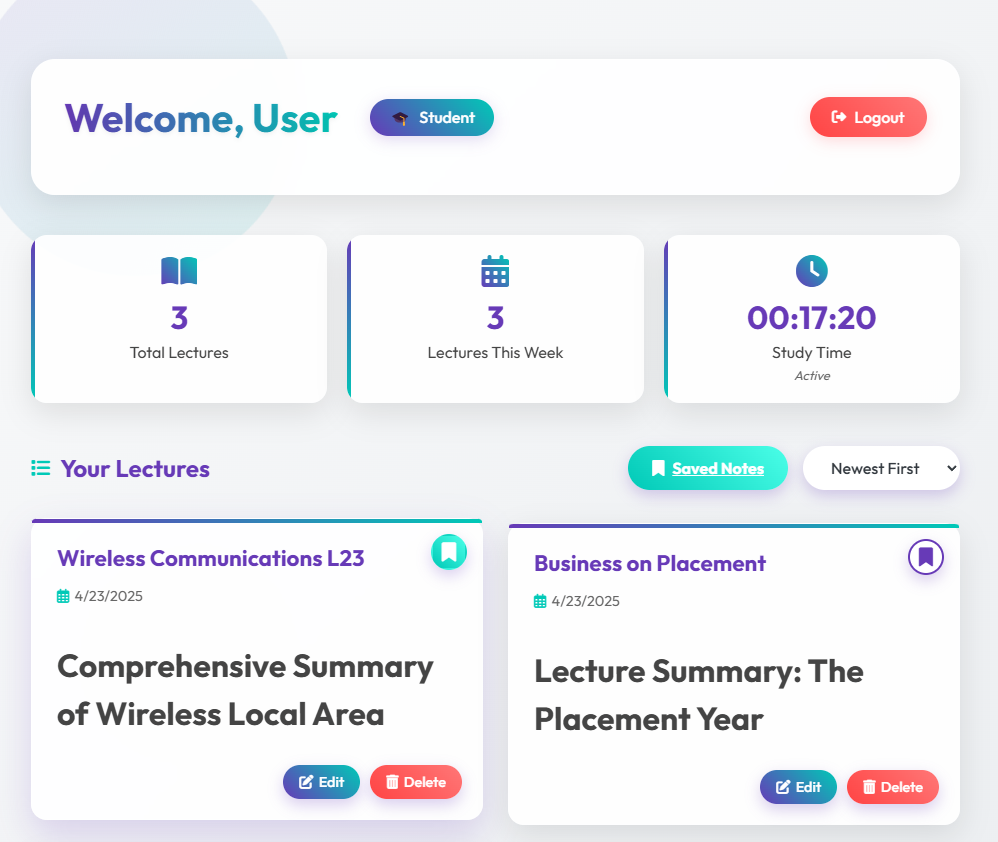
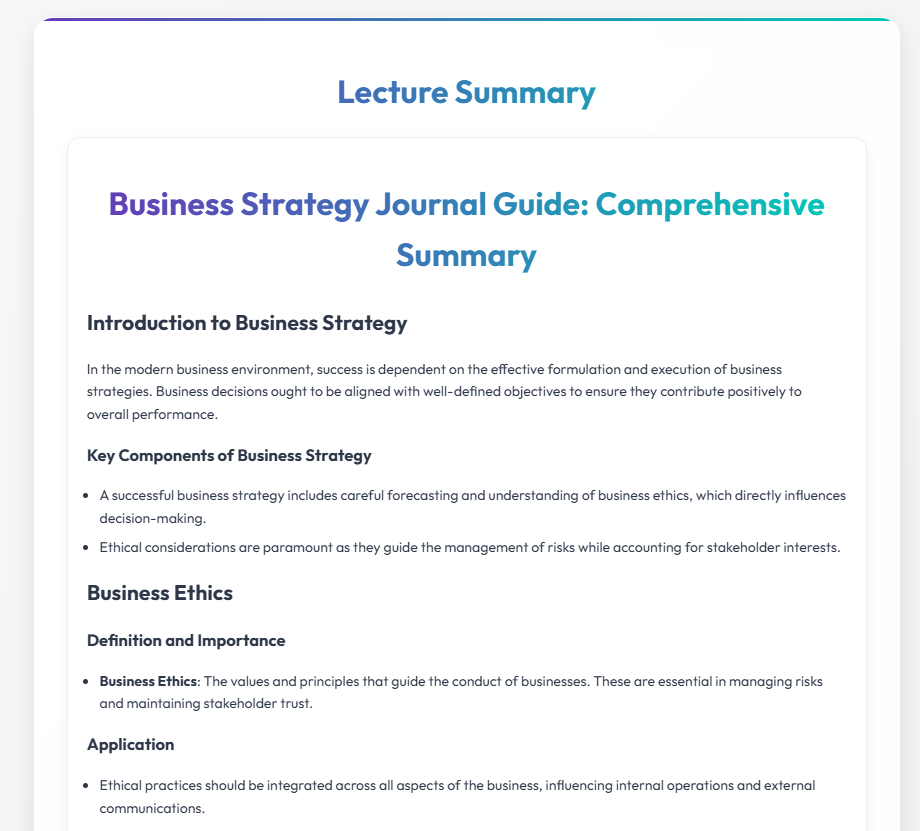
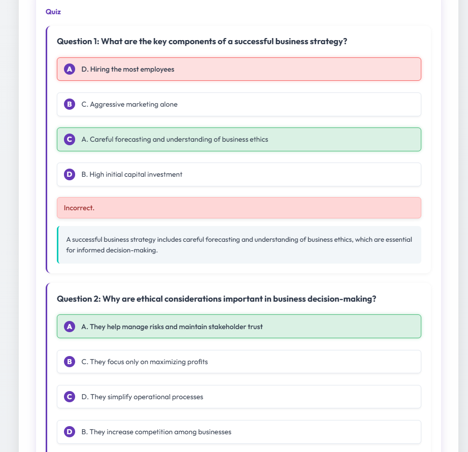
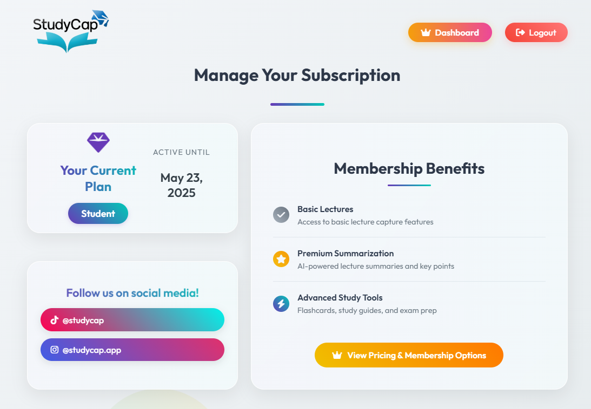

<p align="center">
  
</p>

<h1 align="center">StudyCap</h1>

<p align="center">
  <b>AI study assistant that turns recorded university lectures into summaries, quizzes and an interactive tutor.</b><br>
  A Chrome extension + Flask web app, built and run as a startup by
  <a href="https://github.com/VasmanARF">Vasilis Pittalis</a> and
  <a href="https://github.com/rubenfernandezz">Ruben Fernandez</a> (2025).
</p>

<p align="center">
  
  
  
  
  
  
</p>

> **Project status: concluded.** StudyCap ran as a live product at study-cap.com with paying subscribers.
> The company has wound down and the code is published here as an open-source portfolio piece.
> All production credentials have been removed. To run it yourself, supply your own keys (see [Running locally](#running-locally)).

---

## What it does

Students watching a lecture recording (e.g. on **Panopto**) click the StudyCap extension. It pulls the lecture's captions,
optionally combined with the lecture slides (PDF / PowerPoint), and the web app turns them into:

- **Exhaustive lecture summaries** with section headings and properly rendered maths (LaTeX via KaTeX)
- **Auto-generated quizzes** with explanations for each answer
- **"Chat with StudyCap"**, a tutor that answers questions grounded in that specific lecture
- **"Explained on YouTube"**, ranked YouTube videos covering the lecture's topics (YouTube Data API)
- **Downloadable summaries** and a personal dashboard of saved lectures and notes

<p align="center">
  
  
</p>
<p align="center">
  
  
</p>

## Architecture

```
┌──────────────────────┐   captions + slides    ┌────────────────────────────┐      ┌──────────────┐
│  Chrome extension    │ ─────────────────────▶ │  Flask web app (App Engine) │ ───▶ │  OpenAI API  │
│  (Manifest V3)       │                        │  • /api/generate            │      └──────────────┘
│  • content.js scrapes│ ◀── access / limits ── │  • Google OAuth login       │      ┌──────────────┐
│    Panopto captions  │                        │  • Stripe subscriptions     │ ───▶ │ YouTube API  │
│  • popup.js UI, PDF  │                        │  • Lecture viewer / quiz /  │      └──────────────┘
│    upload, tier info │                        │    chat / dashboard         │      ┌──────────────┐
└──────────────────────┘                        └────────────────────────────┘ ───▶ │ Cloud SQL    │
                                                                                     │ (MySQL)      │
                                                                                     └──────────────┘
```

| Area | Details |
|---|---|
| **Backend** | Python 3.12, Flask, Gunicorn, deployed on Google App Engine (standard) |
| **Database** | MySQL on Google Cloud SQL (users, saved lectures, summary-generation quotas, referral & QR-code tracking) |
| **AI** | OpenAI `gpt-4o-mini` for summaries, quizzes and chat, with prompt engineering for exhaustive, LaTeX-formatted output |
| **Auth** | Google OAuth 2.0 (Authlib), session cookies shared with the extension |
| **Payments** | Stripe Checkout, Customer Portal and webhooks for Free / Student / Premium tiers with daily usage limits |
| **File parsing** | PyMuPDF / PyPDF2 for PDFs, python-pptx for PowerPoint slides |
| **Growth tooling** | Referral codes for content creators, QR-code campaign tracking, email sign-up funnels, PostHog analytics |
| **Extension** | Chrome Manifest V3: content script, service worker, popup UI |

## Repository layout

```
studycap/
├── web-app/                 # Flask backend + server-rendered frontend
│   ├── app.py               # Routes: auth, payments, AI generation, dashboard, admin
│   ├── db.py                # MySQL data-access layer
│   ├── database_config.py   # Cloud SQL socket vs. local TCP config
│   ├── routes/feedback.py   # User feedback blueprint
│   ├── templates/           # Jinja2 pages (landing, dashboard, lecture viewer, pricing, ...)
│   ├── static/              # CSS, JS, images, demo media
│   ├── .env.example         # All required environment variables
│   └── app.yaml.example     # App Engine config template
└── chrome-extension/        # The StudyCap Chrome extension
    ├── manifest.json
    ├── content.js           # Caption extraction + generation request
    ├── popup.html / popup.js
    └── background.js
```

## Running locally

### Web app

```bash
cd web-app
python -m venv .venv
source .venv/bin/activate        # Windows: .venv\Scripts\activate
pip install -r requirements.txt
cp .env.example .env             # then fill in your own keys
python app.py
```

You will need:
- A MySQL database (tables are created automatically by `db.py`)
- A Google OAuth client (authorised redirect URI: `http://localhost:8080/login/google/authorize`)
- An OpenAI API key
- Stripe **test** keys and your own Price IDs (replace the IDs in `app.py` → `get_tier_from_price_id` and the `/pay-*` routes)

> Note: the extension and some CORS settings point at `https://study-cap.com`, the original production domain, which is no longer active.
> To run end to end, replace those URLs with `http://localhost:8080` (or your own deployment).

### Chrome extension

1. Open `chrome://extensions` and enable **Developer mode**
2. Click **Load unpacked** and select the `chrome-extension/` folder
3. Open a Panopto lecture and click the StudyCap icon

## What we learned

Building StudyCap end to end meant handling far more than the AI part:
shipping a browser extension through the Chrome Web Store, real payments and subscription lifecycles with Stripe webhooks,
OAuth across an extension and a web app, cost control on LLM usage (token budgeting and per-tier daily limits),
a mobile-friendly UI, and growth experiments (referrals, QR campaigns, email funnels) driven by analytics.

## Authors

- **Vasilis Pittalis** ([@VasmanARF](https://github.com/VasmanARF)): co-founder
- **Ruben Fernandez** ([@rubenfernandezz](https://github.com/rubenfernandezz)): co-founder

The original development history (~270 commits across both codebases) lived in private repositories. This public repo is a sanitized snapshot of the final version.

## License

[MIT](LICENSE)
